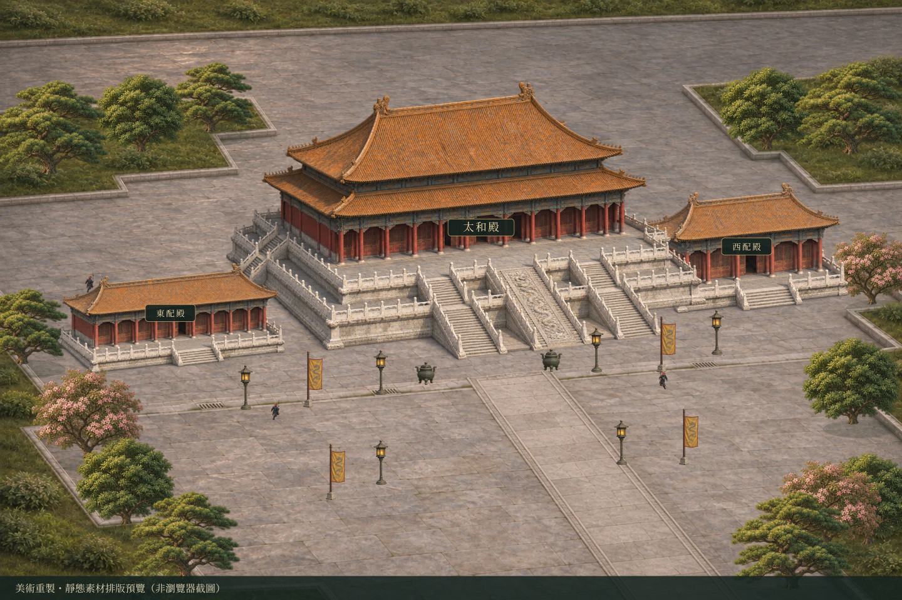

# 大清帝國 · 太和殿 PixiJS 美術測試

獨立 Vite + TypeScript + PixiJS 8 實驗。1 座太和殿、2 座配殿、石磚廣場、台基階梯、樹木、4 面旗、4 名巡邏士兵。無後端、帳號、存檔、GPT API、外部素材 CDN 或正式部署整合。

**交付狀態：已完成第二次美術重製，六張來源圖與十二張執行素材全部替換；靜態排版已檢查，建置與邏輯／素材檢查通過。雲端預覽轉送失敗，尚未完成瀏覽器畫面、實際互動或 FPS 驗收。不能將本專案視為已達成參考圖品質或效能目標。**

## 本機啟動

安裝免費 Node.js 22.18+（或 Node 24 LTS），下載本目錄，於命令列執行：

```sh
cd experiments/pixi-palace-art-test
npm ci
npm run dev
```

開啟終端顯示的本機網址（通常為 http://localhost:5173）。直接下載獨立 ZIP 時，在解壓後的專案根目錄執行 `npm ci` 即可。

Production build 與本機驗證：

```sh
npm test
npm run build
npm run preview
```

通常使用 http://localhost:4173。需由 HTTP 伺服器提供，不支援雙擊 `index.html` 的 file:// 開啟方式。

手機可在與電腦相同的區域網路，開啟終端顯示的 Network URL。手機效能必須在實機測量。

## 操作

- 滑鼠左鍵拖曳場景；滾輪以游標位置為中心縮放。
- 手機單指拖曳、雙指平移與縮放。
- 點選太和殿顯示金色外緣高亮；點選空地取消。拖曳或雙指操作不觸發選取。
- 白晝／夜晚、動畫開啟／關閉、重置鏡頭；右上顯示約每 0.5 秒更新的 FPS。
- 停止動畫會凍結士兵及旗幟，鏡頭與晝夜按鈕仍可操作。系統要求減少動態時預設停止動畫。
- 鏡頭縮放限制為初始比例的 0.85–2.6 倍。直式螢幕聚焦太和殿，可拖曳查看兩側。

## 架構與隔離

- `src/main.ts`：場景分層、深度排序、巡邏、旗布網格動畫、互動及效能採樣。
- `src/camera.ts`：鏡頭縮放及邊界計算。
- `src/layout.json`：遊戲與靜態排版預覽共用的場景座標。
- `scripts/render-layout.mjs`：輸出實際素材排版證明圖，不執行 PixiJS、不測量 FPS。
- `public/assets/`：執行時只載入 12 張 WebP 與 JSON manifest。
- `source-art/`：6 張本次重製的原始 PNG；不進入 production build。
- `scripts/prepare-assets.mjs`：以 Sharp 裁切、透明邊緣修整、WebP 編碼；`npm run assets` 可重建。
- `tests/`：游標中心縮放、縮放上限與桌面／直式鏡頭邊界測試。
- `docs/ASSETS.md`：素材尺寸、來源、容量與限制。
- `docs/PERFORMANCE.md`：驗證結果與可重現的測量方式。

## 本次美術重製

太和殿、配殿、地面、樹木、士兵、旗幟與銅器均重新生成。採較高的西南斜俯視角、陶瓦質感、深朱紅木構與有風化細節的漢白玉；主殿與三層台基一起生成以避免拼接比例差異。配殿沿用主殿圖作為視覺參考。地面改為斜向石磚及低矮植栽帶，樹木落點對應植栽區；士兵改為俯視四方向、每方向兩幀。



此圖直接使用執行用 WebP 與共用場景座標，以 SVG / Sharp 排版輸出；不是概念圖背景，也不是瀏覽器截圖，不包含鏡頭、HTML 控制列、旗布動畫、夜景或 FPS。執行 `node scripts/render-layout.mjs` 可重建。

渲染分為地面、陰影、可排序建築／人物、夜間燈光、標籤。建築與人物使用地面接觸位置的 Y 值排序；太和殿與台基組為一個深度單位。巡邏路線避開主殿台基，兩側路線經過配殿前後以展示遮擋。

本目錄有獨立 package.json 與 lockfile。沒有修改專案根目錄依賴、正式版本號、正式遊戲程式、存檔或 `.github` 工作流程。沒有執行 clasp 或 GAS 操作。僅使用 `experiment/pixi-palace-art-test` 分支，未合併 main，未發布 GitHub Pages。

## 已知限制與尚未完成驗證

1. 瀏覽器預覽基礎設施回報 `relay could not open browser port 4173: timed out waiting for relay readiness`；靜態構圖已檢查；觸控、選取與前後遮擋尚待瀏覽器實際驗收。沒有已實測 FPS、冷載入傳輸量或成功截圖。
2. 圖像生成的建築與地面具有近似固定斜俯視角，但不具備精確共同相機標定，不能保證所有素材都是嚴格 45°。不是完整歷史建築復原；主殿及台基已合為一張建築素材；與其他物件的相機一致性仍屬美術近似。
3. 士兵圖集重製為 4 方向 × 2 幀，具有俯視角與姿勢變化，但只有兩幀，步行流暢度仍有限；不宣稱已達人工製作動畫品質。
4. 前後遮擋以物件落地 Y 排序，主殿及台基成組；未製作可走上階梯／穿過欄杆的細部遮罩，巡邏沒有這些路徑。
5. 夜景為整體色調與局部加色光暈，非物理重新打光；白晝素材內的高光仍然存在。建築素材帶有接觸陰影，樹木及人物仍使用簡化陰影，未完成獨立方向性投影貼圖。
6. 太和殿（含台基）WebP 為 1512×877，兩座配殿分別為 838×408、634×409；高倍縮放仍可能顯軟，沒有將素材放大成假 4K。
7. 未在實體電腦 GPU 或手機驗證。桌面 60 FPS、手機 30 FPS 以上仍只是目標。WebGL 不可用時顯示錯誤訊息。

所有套件免費：PixiJS、Vite 使用 MIT，TypeScript 與 Sharp 使用 Apache-2.0。圖片由本次對話的圖片生成工具產生；網站執行時不會使用任何生成服務或付費 API。
